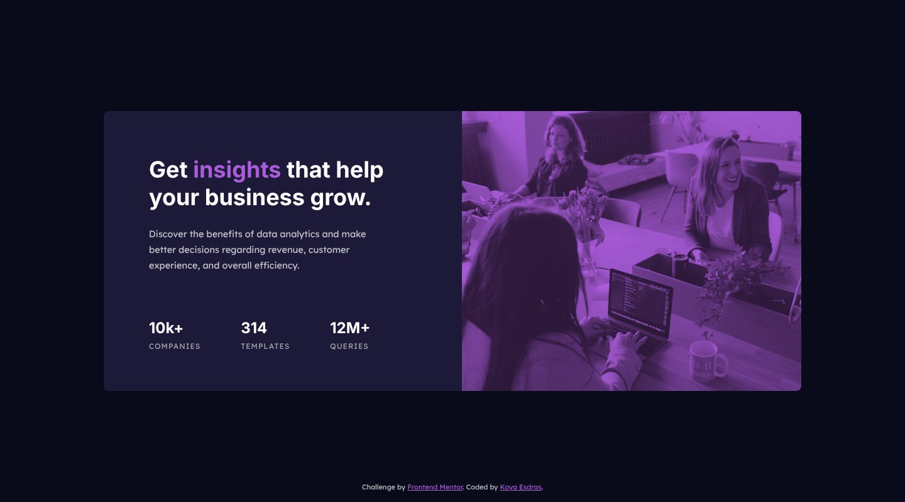

# Frontend Mentor - Stats preview card component solution

This is a solution to the [Stats preview card component challenge on Frontend Mentor](https://www.frontendmentor.io/challenges/stats-preview-card-component-8JqbgoU62). Frontend Mentor challenges help you improve your coding skills by building realistic projects.

## Table of contents

- [Overview](#overview)
  - [Screenshot](#screenshot)
  - [Links](#links)
- [My process](#my-process)
  - [Built with](#built-with)
  - [Workflow](#workflow)
  - [What I learned](#what-i-learned)
  - [Continued development](#continued-development)
  - [Useful resources](#useful-resources)
  - [AI Collaboration](#ai-collaboration)
- [Author](#author)

## Overview

### Screenshot



### Links

- Solution URL: [frontendmentor.io/solutions/stats-preview-card-component-EdVUT3IUiV](https://www.frontendmentor.io/solutions/stats-preview-card-component-EdVUT3IUiV)
- Live Site URL: [ounokoya.github.io/stats-preview-card](https://ounokoya.github.io/stats-preview-card/)

## My process

### Built with

- Semantic HTML5: an `article` in `main`, the title as the page's `h1`, the statistics as a description list (`dl`), the photo in a `picture` element (desktop and mobile crops), decorative
- The purple photo tint in CSS: a Purple 500 background and the photo in `mix-blend-mode: multiply` at 75 % opacity, measured against the design file
- [Tailwind CSS v4](https://tailwindcss.com/) — design tokens in `@theme`, default palette removed, a named `link` utility
- Inter and Lexend Deca served with the site through [Fontsource](https://fontsource.org/)
- The attribution in white at 75 % with Purple 500 links on the dark page (4.89:1) instead of the starter's blue (2.72:1)
- [Vite](https://vite.dev/) for the build, deployed on GitHub Pages from the `gh-pages` branch (`npm run deploy`)
- [Playwright](https://playwright.dev/), [axe-core](https://github.com/dequelabs/axe-core), the W3C Nu validator, html-validate and ESLint for tests

### Workflow

This is version 2 of my 2023 solution, rebuilt from the current starter in the same repository. Before any code, the design was analysed and rebuilt:

1. **Visual analysis in Excalidraw** — measurements in px, contrast checks, the HTML tree → [`specs/visuel/`](./specs/visuel/)
2. **Penpot mockup** — library, desktop, mobile and tablet screens, visual thresholds calibrated against the design JPGs → [`specs/visuel/penpot/`](./specs/visuel/penpot/)
3. **Spec, then tests** — 17 Given/When/Then scenarios and the accessible names the tests rely on → [`specs/specifications/`](./specs/specifications/); the tests were written before the code and checked to fail on the starter
4. **Decisions** — tokens, fonts, the tinted photo, the layout → [`specs/adr/`](./specs/adr/)
5. **Code**, then a walk-through in a real browser → [`specs/analyse/`](./specs/analyse/)

### What I learned

**Finding a blend by measuring it.** Comparing the starter photo with the design pixel by pixel, a plain `multiply` was off by 14 to 35 per channel; a purple background under the photo in `multiply` at 75 % opacity is off by about 2:

```html
<picture class="isolate block bg-purple-500">
  <source media="(min-width: 64rem)" srcset="./images/image-header-desktop.jpg">
  
</picture>
```

**The style guide's size was not the design's.** The paragraph is 15 px in the style guide, but the design's lines measure 14.2 to 14.5 px; at 15 px the sentence breaks in different places. The site uses 14.5 px.

**Comparing colours, not strings.** Tailwind writes `text-white/75` as `oklab(… / 0.75)`; the tests now compare the rendered colour, so the same colour written two ways passes.

### Continued development

- **Visual comparison with the design files.** Screenshots differ from the Frontend Mentor JPGs by 1.06 % (desktop) and 2.85 % (mobile) of pixels, for a 5 % threshold.
- **Tablet**: my own proposal, the mobile card centred below 1024 px.

### Useful resources

- [MDN — `mix-blend-mode`](https://developer.mozilla.org/en-US/docs/Web/CSS/mix-blend-mode) — the photo tint.
- [MDN — `<picture>`](https://developer.mozilla.org/en-US/docs/Web/HTML/Reference/Elements/picture) — a different crop for each width.
- [MDN — `<dl>`](https://developer.mozilla.org/en-US/docs/Web/HTML/Reference/Elements/dl) — label and value pairs.

### AI Collaboration

I used **Claude (Claude Code)** as a pair, inside my own spec-driven workflow where I validated each step before the next one:

- **Planning**: Claude listed my old solutions that needed a rebuild and wrote the plan, which I validated.
- **Design analysis and mockup**: Claude measured the JPG designs, drew the annotated Excalidraw analysis and built the Penpot mockup; I reviewed both and decided on the attribution colours, "12M+", the decorative photo and its tint, the statistics markup, the tablet layout and the paragraph size.
- **Spec and tests**: written by Claude before any code, from the validated mockup.
- **Technical decisions**: fonts from Fontsource, as in my earlier solutions without font files in the starter.
- **Code**: written by Claude from the spec — I confirmed this split at the code lock — with the tests run at each step.

What worked well: comparing the page with the design pixel by pixel explained every difference before it was fixed. What needed my decisions: the choices listed above.

## Author

- Frontend Mentor - [@ounokoya](https://www.frontendmentor.io/profile/ounokoya)
- GitHub - [@ounokoya](https://github.com/ounokoya)
